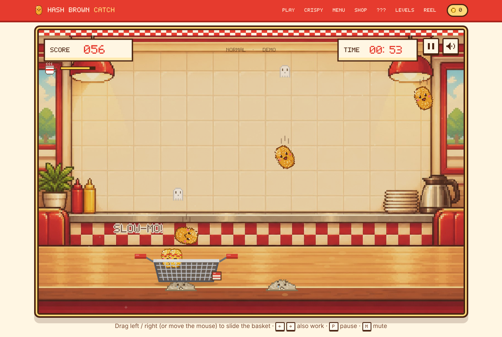

# Hash Brown Catch 接住薯饼！

An 8-bit breakfast mini-game for the browser, built with **p5.js**. Slide a fry basket left and right to catch falling hash browns. Catch one and it crunches into the basket; miss one and it turns into a sad little mash with a ghost floating out of it.

**Play it:** https://sd5913.github.io/Hash-Brown-Catch/

**Planning board:** https://github.com/orgs/sd5913/projects/6 · **Weekly progress:** [docs/progress](docs/progress/)

## Idea and audience

- **Who it is for:** students and office workers who want a 1-minute break, and casual players on phones or laptops. No account, no install.
- **What they do:** move the mouse, drag a finger or use the arrow keys to slide the basket under falling hash browns.
- **How it responds:** every catch gives a golden flash, a crunch sound and points; every miss gives a squelch, a mashed potato and a little ghost. Things fall faster as the 60-second round runs out.
- **Multimedia:** pixel-art sprites drawn in code, a diner background illustration, frame animation and synthesised sound effects.

## How to play

| Falling item | Catch it | Miss it |
|---|---|---|
| Hash brown | +10, crunch and golden flash | −2, becomes a sad mash with a ghost |
| Golden hash brown | +30 | −2 |
| Burnt hash brown | −5 and your combo resets | nothing, it was a decoy |
| Hot sauce bomb | −15, explosion, basket stunned for 0.9 s | nothing |
| Coffee | everything falls at half speed for 4 s | — |
| Alarm clock | +5 seconds | — |

Ten catches in a row gives a +20 combo bonus. The score never goes below 0. Difficulty: Easy, Normal, Hard, Hell, or Custom (fall speed, drop rate, hazards, basket size, round length).

Controls: mouse / touch drag, or ← → (A / D). **P** pauses, **M** mutes.

### Coins, shop and the easter egg

- Every round's score is banked as **coins** that never reset. The **Counter Shop** sells scenes, hash brown flavours, sauces, ghost colours and bomb styles (300 / 800 / 1,500 / 3,000 coins).
- Caught hash browns **stack up** in the basket. Missed ones stay on the counter as mash and their ghosts float up to the ceiling.
- **The Evil Potato Dog:** about 1 in 40 hash browns turns into a deadpan potato dog in mid-air. Catch it for double points (+20). Five styles to collect in the Dog-Dex.

## Run it

**Prerequisites:** a modern browser (Chrome, Edge, Firefox or Safari) and an internet connection (p5.js loads from cdnjs). Python 3 if you want to run a local server.

1. **Online:** open https://sd5913.github.io/Hash-Brown-Catch/
2. **Locally:** clone the repository, then in the project folder run `python3 -m http.server 8000` and open <http://localhost:8000>. VS Code's *Live Server* extension also works.

Shortcut: double-click `start.command` (macOS) or `start.bat` (Windows); it starts the server and opens the game.

Double-clicking `index.html` also works, but sound is switched off because p5.sound cannot start on a page opened as a local file. A yellow note on the page says so.

**Platforms:** desktop browsers (mouse or keyboard) and phone browsers (touch). Tested in Chrome and Safari.

**Limitations**
- Needs internet for p5.js (offline: put p5.js 1.9.4 in `lib/` and point the two `<script>` tags at it).
- Best scores, coins and shop purchases are saved in the browser's localStorage, so they stay on one device and one browser.
- Sound starts only after the first click or tap (browser autoplay rules), and only when the page is served over http(s), not opened as a local file.

## Project structure

| Path | What it is |
|---|---|
| `index.html` | The page: game stage and screens, shop, Dog-Dex, character page, demo reel |
| `js/sketch.js` | p5.js game: setup / draw loop, input, collision, scoring, difficulty, sound |
| `js/sprites.js` | Pixel sprites generated in code (no image files) |
| `js/shop.js` | Coin wallet, shop catalogue and Dog-Dex (localStorage) |
| `js/ui.js` | Menus and screens around the canvas |
| `css/style.css` | Page styles |
| `assets/` | Diner background, sound effects, pixel fallback font |
| `tools/` | Python scripts that regenerate the sound effects and the font |
| `docs/` | Proposal, team roles, weekly progress, tests and playtests |

## Course mapping

- **Input & response:** `mouseX`, `mouseIsPressed`, touch events, `keyIsDown()`, `keyPressed()` (pause / mute).
- **Images & frame animation:** sprites become `p5.Graphics` frames; hash browns swap between two falling frames, a *worried* frame near the floor, a *caught* frame and a *mash* frame.
- **Sound:** `loadSound()`, `setVolume()`, `rate()`, `play()`, `outputVolume()` for mute.

## Team and process

| Member | Role | Owns |
|---|---|---|
| CHEN Yueru | Gameplay & integration lead | `js/sketch.js` (input, collision, scoring, difficulty, game states), GitHub Pages deployment, repository settings |
| MA Qianran | Art & character (IP) lead | `js/sprites.js` (Crispy, expressions, flavours, the Evil Potato Dog), scenes, concept art, character page, demo reel |
| LI Jiarui | UX, sound & QA lead | `js/ui.js` and screens (start, pause, results, shop UI), sound effects, playtests, README / credits / progress notes |

Everyone reviews at least one pull request from another member each week.

- Planning board: https://github.com/orgs/sd5913/projects/6
- Weekly progress notes: [docs/progress](docs/progress/)
- Test log: [docs/test-log.md](docs/test-log.md)
- Changelog (what changed each week and why): [docs/changelog.md](docs/changelog.md)
- UX tests: [docs/playtest](docs/playtest/)
- Assessment map (where each requirement is evidenced): [docs/assessment-map.md](docs/assessment-map.md)

## Credits

**Libraries**
- [p5.js](https://p5js.org) 1.9.4 (LGPL-2.1) and p5.sound (MIT), loaded from cdnjs.

**Fonts**
- *Press Start 2P* by CodeMan38 and *Pixelify Sans* by Stefie Justprince, both from Google Fonts under the SIL Open Font License.
- *Crunch Pixel* (fallback pixel font): made by us with `tools/make_font.py`.

**Art**
- Crispy, every expression, the items, mash, ghosts, flavours, bombs and the Evil Potato Dog are pixel sprites generated in code in `js/sprites.js`.
- Diner background illustration and early concept sheets: generated with **ChatGPT** (OpenAI image generation) from our prompts and art direction.
- The Evil Potato Dog is our own pixel design. Its deadpan, tired-office-worker mood was inspired by Korean sticker characters such as Nudaeng (누댕이, pp.studio); no artwork from them is used.

**Sound**
- All sound effects are synthesised from scratch by `tools/make_sfx.py` (no recorded samples).
- Demo reel music: a short chiptune loop synthesised in the same way.

**How we used AI**
- **Claude (Anthropic)** helped draft most of the code (`sketch.js`, `sprites.js`, `ui.js`, `shop.js`), the sound and font scripts, and the demo reel recording. We set the design and rules, reviewed and tested every change, tuned the gameplay from our playtests and can explain each part of the code.
- **ChatGPT** generated the background illustration and concept images.
- Game design, rules, character direction, testing and documentation decisions are the team's.

## Secrets

None. The game needs no API keys, passwords or accounts.
